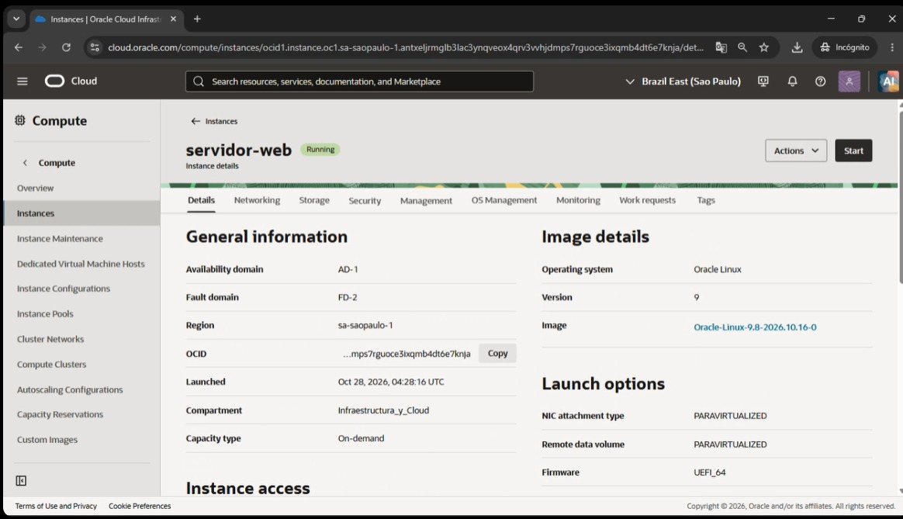
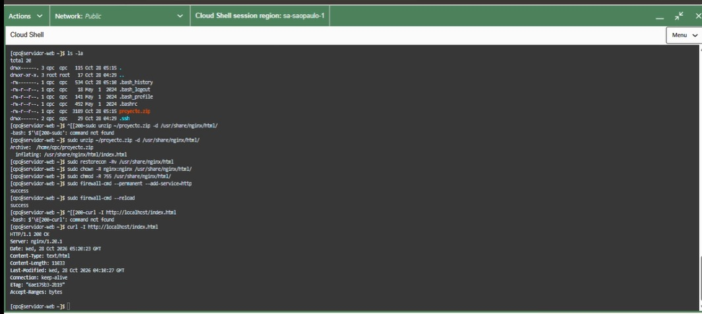
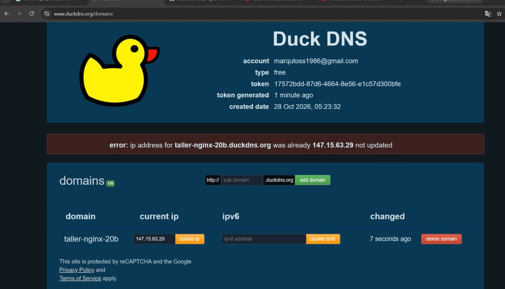
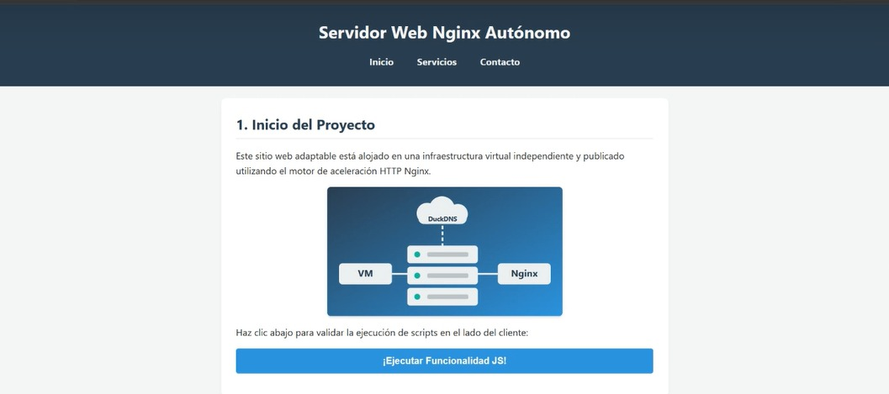

# Guía paso a paso: publicar una página web con Nginx en una VM de Oracle Cloud y acceder con un subdominio de DuckDNS

**Estudiante:** Marco Aurelio Guevara Cuca Y Yury Paola Velez Arias
**Asignatura:** Redes y Servicios — Taller de Redes e Infraestructura
**Subdominio:** `http://taller-nginx-20b.duckdns.org`
**Repositorio:** [https://github.com/marqutoss-netizen/guia-nginx-duckdns](https://github.com/marqutoss-netizen/guia-nginx-duckdns)

---

## Resumen de la arquitectura

| Componente | Detalle |
|---|---|
| Nube | Oracle Cloud Infrastructure (región Brazil East – São Paulo) |
| Máquina virtual | `servidor-web` (Oracle Linux 9, shape `VM.Standard.E5.Flex`, 1 OCPU, 12 GB RAM) |
| Servidor web | Nginx 1.20.1 |
| IP pública | `147.15.63.29` |
| IP privada | `10.0.0.127` |
| DNS dinámico | DuckDNS → `taller-nginx-20b.duckdns.org` |

Flujo: **Navegador → taller-nginx-20b.duckdns.org → 147.15.63.29 → VM `servidor-web` (Nginx, puerto 80)**

---

## Paso 1. Crear una nueva máquina virtual

1. Ingresar a la consola de Oracle Cloud y abrir **Compute → Instances**.
2. Seleccionar el compartimento `Infraestructura_y_Cloud`.
3. Pulsar **Create instance** y configurar:
   - **Nombre:** `servidor-web`
   - **Imagen:** Oracle Linux 9
   - **Shape:** `VM.Standard.E5.Flex` (1 OCPU, 12 GB de memoria)
   - **Red:** reutilizar la VCN y la subred pública del taller inicial
   - **Llaves SSH:** generar o cargar una llave y guardar la llave privada
4. Esperar a que el estado sea **Running**.

Detalles de la instancia creada (región `sa-saopaulo-1`, dominio de disponibilidad AD-1, dominio de fallos FD-2, Oracle Linux 9):



Lista de instancias, donde se ven la IP pública `147.15.63.29` y la IP privada `10.0.0.127`:


---

## Paso 2. Abrir el puerto 80 en la red de Oracle Cloud

Para que la página sea accesible desde Internet hay que permitir el tráfico HTTP:

1. En la instancia, abrir la subred y entrar a **Security Lists** (o al Network Security Group asociado).
2. Agregar una regla de entrada (**Ingress Rule**):
   - **Source CIDR:** `0.0.0.0/0`
   - **IP Protocol:** TCP
   - **Destination Port Range:** `80`

---

## Paso 3. Conectarse a la VM e instalar Nginx

1. Conectarse a la VM por SSH con el usuario `cpc` (o desde Cloud Shell):

```bash
ssh -i ruta/a/llave_privada.key cpc@147.15.63.29
```

2. Instalar Nginx, habilitarlo e iniciarlo:

```bash
sudo dnf install -y nginx
sudo systemctl enable --now nginx
sudo systemctl status nginx
```

---

## Paso 4. Publicar la página web propia

La página (`index.html`) es un único archivo que contiene:

- **Tres secciones:** Inicio del Proyecto, Infraestructura Implementada y Validación de Entrega.
- **Imágenes:** ilustraciones en SVG incrustadas en el propio HTML (no dependen de archivos externos).
- **CSS adaptable (responsive):** usa `grid` con `auto-fit` y una media query `@media (max-width: 600px)`.
- **JavaScript:** un botón que muestra un mensaje de verificación con la fecha y hora actuales.

1. Comprimir el `index.html` en `proyecto.zip` y subirlo a la VM (desde el equipo local):

```bash
scp -i ruta/a/llave_privada.key proyecto.zip cpc@147.15.63.29:~
```

2. En la VM, comprobar que el archivo llegó:

```bash
ls -la
```

3. Descomprimirlo en la carpeta raíz de Nginx:

```bash
sudo unzip ~/proyecto.zip -d /usr/share/nginx/html/
```

4. Restaurar el contexto de SELinux y ajustar propietario y permisos:

```bash
sudo restorecon -Rv /usr/share/nginx/html
sudo chown -R nginx:nginx /usr/share/nginx/html/
sudo chmod -R 755 /usr/share/nginx/html/
```

5. Abrir el puerto HTTP en el firewall de la VM y recargar las reglas (ambos comandos responden `success`):

```bash
sudo firewall-cmd --permanent --add-service=http
sudo firewall-cmd --reload
```

6. Verificar que Nginx responde localmente:

```bash
curl -I http://localhost/index.html
```

Resultado: `HTTP/1.1 200 OK` con `Server: nginx/1.20.1`.



---

## Paso 5. Configurar el subdominio de DuckDNS

1. Ingresar a [https://duckdns.org](https://duckdns.org) e iniciar sesión.
2. En **domains**, escribir el subdominio `taller-nginx-20b` y pulsar **add domain**.
3. En el campo **current ip**, escribir la IP pública de la VM, `147.15.63.29`, y pulsar **update ip**.
4. Verificar que el dominio quede asociado a esa IP. El mensaje _"ip address ... was already 147.15.63.29 not updated"_ indica que la IP ya estaba registrada correctamente.



---

## Paso 6. Comprobar el funcionamiento desde un navegador externo

1. Desde un equipo o celular **fuera de la VM**, abrir:

```
http://taller-nginx-20b.duckdns.org
```

2. Verificar que cargan las tres secciones y las imágenes.
3. Pulsar el botón **¡Ejecutar Funcionalidad JS!** y comprobar que aparece el mensaje de verificación.
4. Reducir el ancho de la ventana (o abrirlo en el celular) para confirmar que el diseño se adapta.

> Se usa **HTTP** (no HTTPS), ya que no se configuró certificado.




